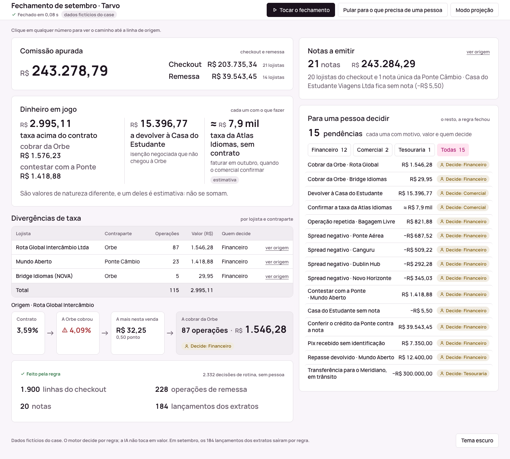
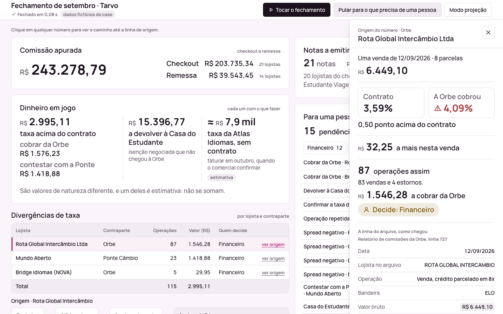
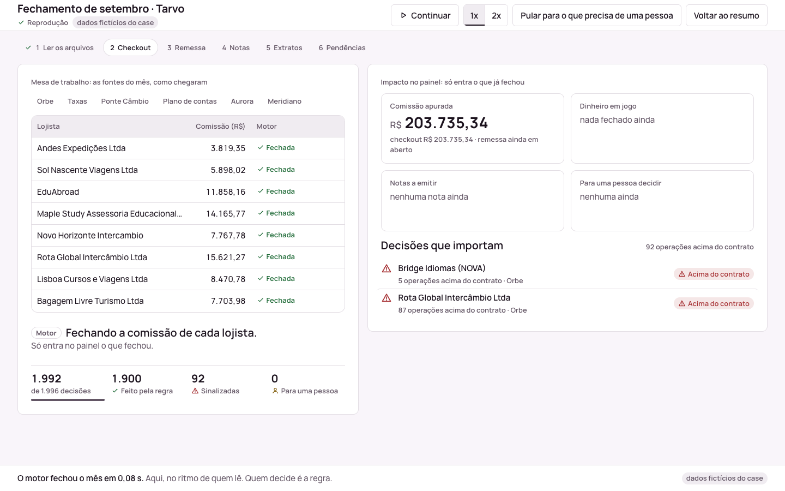

# Tarvo: fechamento mensal com rastro

> **Versão avaliada:** tag [`entrega-2026-10-17`](https://github.com/fernando-bertholdo/tarvo-month-end-close/tree/entrega-2026-10-17) (17/10/2026, 18:24 BRT). Tudo o que veio depois é refino pós-desafio, descrito em [POS-ENTREGA.md](POS-ENTREGA.md) e resumido em [Depois da entrega](#depois-da-entrega).

Fecha o mês da Tarvo Pagamentos a partir dos arquivos como eles chegam (Orbe, planilha de taxas, e-mail da Ponte Câmbio, extratos Aurora e Meridiano, plano de contas e o ajuste tardio da Orbe) e entrega comissões, divergências, notas, lançamentos classificados e pendências. Todo número aponta para a linha de origem.

**O número nunca passa pela IA.** Todo valor em reais sai de regra escrita a partir das respostas do financeiro ([REGRAS.md](REGRAS.md)).

## Resultado de setembro/2026

| | Valor | Onde ver |
|---|---|---|
| Comissão de checkout (21 lojistas) | R$ 203.735,34 | `comissoes_por_lojista.csv` |
| Comissão de remessa (14 lojistas) | R$ 39.543,45 | idem; nota única da Ponte Câmbio |
| A cobrar da Orbe (taxa acima do contrato) | R$ 1.576,23 (Rota Global e Bridge) | `divergencias_taxa.csv`, `pendencias.csv` |
| A contestar com a Ponte (spread acima do contrato) | R$ 1.418,88 (Mundo Aberto) e 4 spreads negativos | idem |
| A devolver à Casa do Estudante (isenção não avisada à Orbe) | R$ 15.396,77 | `pendencias.csv` |
| Não faturado até o comercial fechar a taxa (Atlas) | bruto de R$ 262.138,61 | `pendencias.csv` |
| Notas a emitir | 21 (R$ 243.284,29) | `notas_a_emitir.csv` |
| Lançamentos classificados | 184, todos por regra | `lancamentos_classificados.csv` |
| Pendências para uma pessoa | 15, com motivo e área | `pendencias.csv` |

## Como rodar

Pré-requisito: Python 3.8 ou mais novo (testado em 3.8 e 3.14). Nada a instalar: só biblioteca padrão. Tudo a partir da raiz do repositório.

**1. O comando (caminho da banca).**

```bash
python3 -m src.tarvo dados
```

Lê a pasta do mês, mostra o resumo no terminal e grava os seis arquivos em `saida/`. Também grava, em `relatorio/`, o registro da execução (`execucao.json`: arquivos, linhas, data e hora), o log de decisões (`eventos.jsonl`) e o painel estático (`painel.html`, abre no navegador sem servidor). Leva menos de 1 segundo. Para outro mês, aponte para a pasta dele: `python3 -m src.tarvo dados_outubro`. Nada é fixo para setembro. Se faltar arquivo ou o layout mudar, o comando avisa e fecha o que não depende dele. O arquivo de ajustes da Orbe (`06_...`) é opcional.

**2. A tela ao vivo (opcional).**

```bash
python3 -m src.tarvo.servidor dados
```

Abre `http://127.0.0.1:8765/?ao_vivo=1` com o botão "Rodar fechamento". O clique chama o mesmo motor, e cada decisão aparece na tela assim que acontece. Grava os mesmos arquivos que o comando. `--sem-pausa` tira o ritmo de apresentação.

**Chave de API.** Para setembro nenhuma chave é necessária: todos os lançamentos saem por regra, e o cache versionado da IA reproduz o `saida/`. Para meses com lançamento sem regra, copie `.env.example` para `.env` e preencha `TARVO_ANTHROPIC_API_KEY` com a chave enviada no e-mail de entrega. Sem chave, a solução tenta o Claude Code local; sem nenhum dos dois, o lançamento vira Decisão humana. `python3 -m src.tarvo.teste_chave` confere a chave sem mostrá-la.

## O que sai

| Arquivo | O que é |
|---|---|
| `comissoes_por_lojista.csv` | comissão de cada lojista, por linha de negócio |
| `divergencias_taxa.csv` | transação por transação, taxa contratada × aplicada e a diferença em reais |
| `notas_a_emitir.csv` | uma nota por lojista no checkout e uma para a Ponte Câmbio na remessa |
| `lancamentos_classificados.csv` | cada linha dos dois extratos com a conta, o método (REGRA, IA ou HUMANO), a confiança e a regra |
| `pendencias.csv` | o que precisa de uma pessoa, com motivo e área que decide |
| `rastro.csv` | liga cada `id_saida` às linhas de origem; a soma por `id_saida` bate com o número reportado |

## Estrutura

Um motor só lê a pasta do mês, aplica as regras e, a cada decisão, anota um evento: de onde veio, qual regra, quanto, por quê e se foi regra, IA ou decisão humana. Há dois jeitos de ligar o mesmo motor. O comando no terminal grava os seis arquivos, os eventos e o painel. O servidor local, só com a biblioteca padrão do Python, abre a página com o botão; o clique chama o motor, e cada evento vai para a tela assim que acontece (Server-Sent Events, SSE: o servidor mantém a conexão aberta e empurra as mensagens). Uma página só desenha os eventos, venham do arquivo ou do servidor. O número da tela é o mesmo do CSV, porque os dois saem do mesmo evento. Se a tela falhar, o comando entrega igual.

```text
dados do mês --> motor (regras) --> saida/ (6 CSVs)
                      |
                      +--> eventos --> relatorio/eventos.jsonl --> painel (estático e reprodução)
                                  +--> servidor (SSE) ----------> painel (ao vivo)
```

Código em `src/tarvo/`: `engine.py` (motor), `__main__.py` (comando), `servidor.py` (tela ao vivo), `painel.py` e `vitrine/painel.html` (página), `ia.py` (etapa de IA). Contrato dos eventos em [src/CONTRATO_EVENTOS.md](src/CONTRATO_EVENTOS.md).

## Onde a IA entra e onde não entra

- **Não entra em nenhum valor em reais.** Comissão, divergência, nota e pendência saem de regra.
- **Entra só na conta de lançamento de extrato que nenhuma regra cobre.** Ela propõe uma conta que existe no plano de contas, com confiança e motivo, ou passa o caso para uma pessoa. Resposta validada por esquema; abaixo de 0,90 de confiança, ou se a resposta não validar, vira Decisão humana. Cada decisão fica num cache versionado, para que a mesma rodada dê o mesmo resultado.
- **Na construção:** o Claude Code foi dirigido pelo Fernando, com conferência independente dos totais por um subagente que não viu o código ([PROMPTS/](PROMPTS/)).

## Hipóteses e perguntas ao financeiro

[HIPOTESES.md](HIPOTESES.md) separa o que veio do financeiro (com link) do que foi assumido. As que mais pesam: Atlas fora do faturamento até o comercial fechar a taxa; Casa do Estudante como devolução, fora da cobrança da Orbe; spread negativo sempre fora da nota da Ponte.

## Limitações conhecidas

- A confiança da IA é declarada pelo modelo, não calibrada. Teste cego em 40 lançamentos que a regra já classifica (sem as respostas nem exemplos delas): 29 acertos, nenhuma conta errada, 8 casos passados a uma pessoa e 3 respostas fora do esquema. Com o limite em 0,90, as 25 aceitas estavam certas. A amostra é pequena (`python3 -m src.tarvo.avaliar_ia`).
- A conciliação da Orbe contra o banco, parcela por parcela, não é feita (F33): os créditos da Orbe são classificados, não conciliados.
- O casamento de Pix com lojista usa o começo do nome no extrato; nome novo, fora da planilha e do relatório da Orbe, vai para a etapa de IA ou para uma pessoa.
- A provisão de folha e impostos de setembro é da contabilidade e fica fora (F46).
- Rascunhos de contestação para a Orbe e a Ponte não são gerados: as pendências trazem as operações e os valores.

## O que eu faria com mais um mês

- Rascunho de e-mail de contestação para a Orbe e para a Ponte, um por contraparte, a partir das pendências (F49).
- Conciliação da Orbe contra o banco pela agenda de recebíveis, parcela por parcela.
- Leitura do retorno da contestação no relatório seguinte da Ponte ("AJUSTE REF"), conferindo contra a pendência aberta.
- Teste da IA numa amostra maior, para calibrar a confiança, e uma tela para a Helena aprovar as decisões humanas.

## Depois da entrega

Refino de 18 e 19/10, por pull request, com a versão avaliada intacta na tag. Datas, motivos e quem achou cada ponto em [POS-ENTREGA.md](POS-ENTREGA.md).

- **Motor ([#1](https://github.com/fernando-bertholdo/tarvo-month-end-close/pull/1)).** Sem o relatório da Orbe, o ajuste tardio não entra mais sozinho (antes, a comissão de checkout saía negativa) e vira pendência. A base de cada divergência vai para o evento e para `divergencias_taxa.csv`. O motor emite os totais parciais, e a tela só exibe. O mês sai dos arquivos, e o comando roda de qualquer pasta. Os valores de setembro não mudaram.
- **Testes e reconciliação.** `python3 -m unittest discover -s tests -t .` (89 testes) e `python3 verificacao/reconcilia.py`, que recalcula da fonte os totais de cabeça e sai com erro se algum não bate.
- **Painel ([#2](https://github.com/fernando-bertholdo/tarvo-month-end-close/pull/2)).** Todo número da tela sai de um campo do motor. A origem da divergência da Rota Global fica visível sem clicar, embaixo da tabela, e cada pendência ocupa uma linha, com valor e área que decide.
- **Estúdio (`estudio/`).** O painel e um filme de 84 s do fechamento, feitos com um crítico em contexto novo a cada rodada. Os vídeos estão na Release [`filme-2026-10-18`](https://github.com/fernando-bertholdo/tarvo-month-end-close/releases/tag/filme-2026-10-18).







## Uso de IA

Sessões em [PROMPTS/](PROMPTS/) e momentos em [PROMPTS/MOMENTOS.md](PROMPTS/MOMENTOS.md). As sessões do refino pós-desafio estão listadas em [PROMPTS/pos-desafio/](PROMPTS/pos-desafio/LEIA-ME.md). Usei um template próprio de condução de case (fluxo e regras de trabalho, sem código do case); as regras de como a IA foi dirigida estão em [CLAUDE.md](CLAUDE.md).
